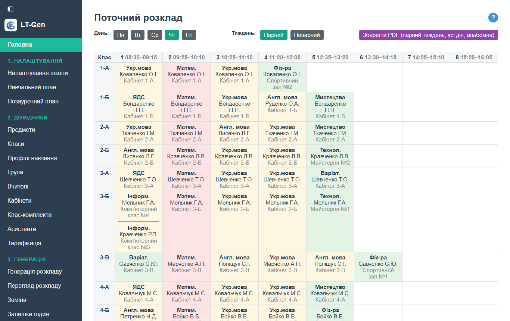
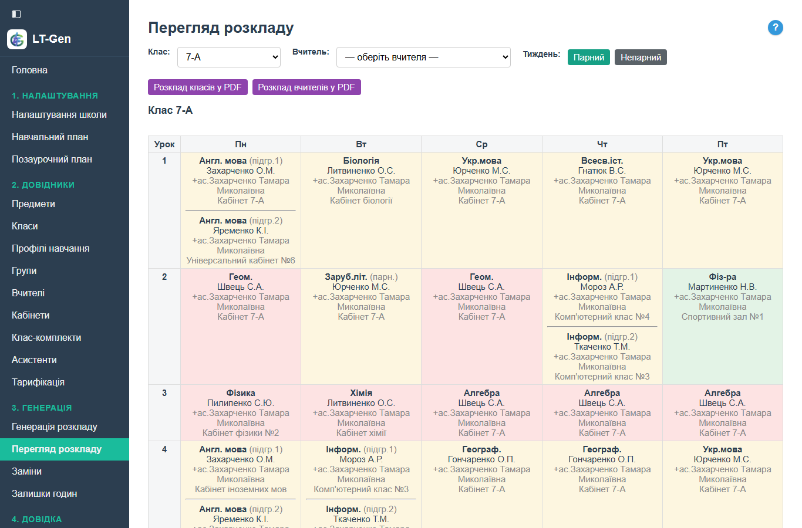
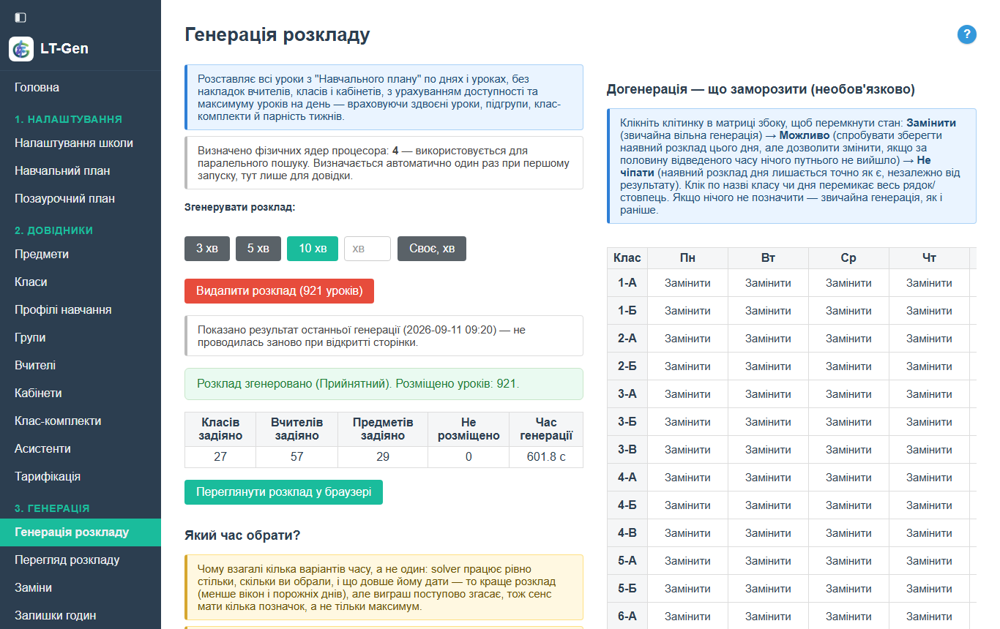

<p align="center">
  
</p>

<h1 align="center">LT-Gen</h1>

<p align="center"><b>L</b>esson <b>T</b>imetable <b>Gen</b>erator — генератор розкладу уроків</p>

<p align="center">
  Веб-застосунок для автоматичного складання розкладу уроків української школи
  з дотриманням санітарного регламенту МОН.
</p>

<p align="center">
  <b>Безкоштовний. Працює локально — своя копія, своя база даних, без хмарних сервісів.</b><br>
  При наявності з'єднання з інтернетом — одиничний запит до GitHub про номер останньої версії. Жодні дані школи не передаються.
</p>

---

## ⬇️ Як завантажити

> ### Не клонуйте цей репозиторій — так програма не запуститься.
>
> Тут лежить **лише вихідний код**, без Python і без потрібних пакетів.
>
> **Готова програма — у розділі [Releases](https://github.com/LT-Gen/Lesson_Timetable_Generator/releases):**
> завантажте архів `School_Schedule_v*.zip`, розпакуйте в будь-яку папку і запустіть
> **`run.bat`**. Портативний Python уже всередині — встановлювати нічого не треба.

Клон репозиторію має сенс лише якщо ви програміст і запускаєте власним Python:
`pip install -r data/requirements.txt`, далі `python data/app.py`.



---

## Область застосування

Чесно про те, що вже працює, а що ні:

| Тип закладу | Стан |
|---|---|
| **1–11, стара школа** (один рівень, одна зміна) | працює; перевірено на даних однієї реальної школи (11 класів) — повний розклад за 5 хв |
| **Початкова (1–4)**, **Гімназія (5–9)**, **1–9** | працює, перевірено на демо-даних (27 класів) |
| **Ліцей (10–12)** | **не підтримується** — вибір рівня заблоковано в інтерфейсі |
| **Друга зміна** | **не підтримується** — розклад складається на одну зміну |

Профільна старша школа (групи, профілі навчання) поки існує лише як **довідники**:
генератор розкладу їх ще не використовує.

Межа — не кількість класів сама по собі, а щільність плану. Орієнтир: 11 класів
звичайної школи складаються повністю за 3–5 хв; 27 класів демо-школи — за 10 хв.
Велика школа з щільними планами (23 класи, інтегровані курси) за 10 хв наскрізного
прогону лишала кілька уроків нерозміщеними — там помітно краще працює генерація
**окремо по рівнях** (1–4, потім 5–9, потім 10–11).

Застосунок перевірено на двох школах — вашої серед них не було. Нижче,
у «Відомих обмеженнях», чесно описано, де він уже спотикався.

---

## Навіщо це

Складання розкладу вручну — це тижні роботи й десятки конфліктів: накладки
вчителів, порушення норм складності предметів, підгрупи, клас-комплекти, парні та
непарні тижні. Застосунок бере рутину на себе: формулює розклад як задачу з
обмеженнями й розв'язує її через **OR-Tools CP-SAT**.

- **Жорсткі правила** (санітарні норми, накладки вчителя / класу / кабінету) —
  **ніколи не порушуються**.
- **М'які переваги** (компактність розкладу, фізкультура не першим уроком тощо) —
  оптимізуються, наскільки дозволяє решта обмежень.

Кожна школа ставить свою копію: свій `run.bat`, своя локальна база. Дані школи
нікуди не передаються.

---

## Основні можливості

### Складання розкладу
- Автоматична генерація за навчальним планом, з урахуванням віку класу
  (тривалість уроку 35 / 40 / 45 хв)
- Багаторівнева генерація: початкова школа й гімназія — окремими незалежними
  прогонами
- Заміни вчителів; догенерація з можливістю «заморозити» частину наявного розкладу
- Збережені варіанти розкладу: кілька названих варіантів у базі, будь-який можна
  повернути як поточний і догенерувати від нього
- Кілька режимів за часом пошуку розв'язку (3 / 5 / 10 хв або своє число хвилин)
- Розклад на семестр: предмети «лише І» чи «лише ІІ семестр» потрапляють у розклад
  свого семестру

### Дотримання норм МОН
- Шкала складності предметів за віковими нормами
- Обов'язковий поділ на підгрупи (наказ №128 у редакції №808) — з блокуванням
  генерації за порушення
- Гранично допустиме тижневе навантаження
- Потижневий облік канікул і навчальних тижнів
- Календар навчального року: свята, карантин та відпрацювання (робочі суботи) —
  борг учителя за пропущені уроки й його закриття видно в «Залишках годин»

### Профільна старша школа (10–12 класи) — підготовка, ще не в генерації
- Типові навчальні плани наказу МОН №1674 — 8 профілів (мовно-літературний,
  соціально-гуманітарний, STEM-кластери), для перегляду
- «Групи» — міжкласні навчальні одиниці з частин реальних класів, з перевіркою складу
- «Профілі навчання» — власний навчальний план кожної групи

> Ці розділи вже можна заповнювати, але **генератор розкладу їх поки не
> використовує**, а рівень «Ліцей» у налаштуваннях закладу заблоковано.

### Довідники та планування
- Класи, клас-комплекти (малокомплектні школи), предмети, кабінети (4 типи
  прив'язки), вчителі, асистенти
- Навчальний і позаурочний план, матриця вчителя (з підсумком годин), тарифікація (звіт)
- Масове додавання записів
- Парність тижнів (дробове навантаження, напр. 0,5 год/тиждень)

### Облік годин
- «Залишки годин» по семестрах і за рік: скасовано по заміні, втрачено через свята
  й карантин, відпрацьовано, проведено по заміні, залишок
- Закриття семестру — прочитане фіксується й не залежить від подальших змін плану
- Затвердження річних годин (тарифікації) на початку року; передача залишку годин
  новому вчителеві, якщо вчитель змінився посеред року

### Експорт
- Розклад у **Excel** і **PDF** — по класах, по вчителях і на кожен день для всієї школи



### Обслуговування
- Демонстраційна база для ознайомлення — перемикання з реальною одним кліком
- Резервні копії: створення, відновлення, імпорт стороннього файлу, повне очищення;
  щоденна автокопія при запуску
- Перехід на новий навчальний рік: випуск, переведення класів зі своїми вчителями,
  плани за торішніми зразками, річне стирається — з попереднім переглядом
- Копія навчального плану з одного класу на інший
- Безпечні оновлення структури бази: автоматична резервна копія перед кожним
  оновленням версії, звіт «нічого не втрачено»

---

## Відомі обмеження

Знайдено на реальних даних; про це варто знати до того, як ви витратите вечір:

- **Інтегровані курси в 1–4** (напр. «Я пізнаю світ» у школах проєкту «Інтелект
  України»). Для 1–4 діє жорстке правило «останнім уроком дня — лише легкий
  предмет», а в такому плані легких предметів менше, ніж днів: частина уроків не
  розміститься. Тимчасовий обхід — знизити складність такого курсу до «легкий» у
  «Предмети → Додатково».
- **Плани, що перевищують граничне навантаження МОН** (той самий випадок:
  третя година фізкультури «схована» всередині інтегрованого курсу). Генерація
  відмовиться стартувати, доки не піднімете норму класу в «Класи → Додатково» до
  фактичної суми плану.
- **Два класи одночасно в спортзалі** окремо не моделюються. Обхід — завести дві
  «половини спортзалу» як окремі кабінети.
- **Пів години на тиждень** застосунок веде як урок раз на два тижні
  (парний/непарний тиждень). Якщо школа натомість читає предмет цілими годинами
  по семестрах — два записи плану з полем «Коли читається» (з версії 0.2.0).
  У «Тарифікації» такий урок раз на два тижні рахується як половина тижнів року,
  а за календарем таких тижнів може випасти трохи інакше — у «Залишках годин»
  наприкінці року можливе розходження на 1–3 год.
- **Одна зміна, один корпус.** Друга зміна, виїзні заняття поза школою (напр.
  міжшкільний осередок «Захист України» раз на місяць) у розкладі не плануються —
  це задається як недоступність класу чи ненавчальний день.
- Генерація **не гарантує** однакового результату двох прогонів: солвер щоразу
  шукає наново, тож повторний запуск на тому самому плані може дати трохи кращий
  або гірший розклад.

Якщо застосунок спіткнувся на вашій школі — найкорисніше, що ви можете зробити,
це створити **Issue** з описом і, якщо можна, знеособленим навчальним планом.

---

## Як це працює

| | |
|--|--|
| Мова / рушій | Python 3.14, Flask |
| Ядро генерації | [OR-Tools](https://github.com/google/or-tools) [CP-SAT](https://d-krupke.github.io/cpsat-primer/) |
| База даних | SQLite (один файл) |
| Інтерфейс | звичайні HTML-форми у браузері, без фреймворків, без AJAX |
| Експорт | openpyxl (Excel), fpdf2 (PDF) |

Застосунок піднімає локальний веб-сервер; робота ведеться в браузері за адресою
`http://127.0.0.1:5000`.



---

## Якщо сталася помилка

При непередбаченому збої застосунок показує сторінку «Сталася помилка» і
дописує технічний опис у файл `base/pomylky.log` поруч із базою. Дані при
цьому не втрачаються. Надішліть цей файл разом з описом, що ви натискали, —
цього досить, щоб розібратися.

## Оновлення версії

Коли вийде нова версія, програма один раз покаже про це банер угорі сторінки
(перевіряє GitHub не частіше ніж раз на добу; без інтернету — мовчить).

1. Закрити вікно сервера старої версії.
2. Розпакувати новий реліз в **окрему** папку (стару не видаляти).
3. Скопіювати `base/school.db` зі старої папки в `base` нової.
4. Запустити `run.bat` — структура бази оновиться сама (перед цим робиться її
   копія), угорі з'явиться звіт про оновлення.

Перенесення на інший комп'ютер: «Резервні копії» → «Створити й скачати копію» у
старій версії, у новій — «Резервні копії» → «Імпорт з файлу» і перезапуск.

## Демонстраційний режим

«Налаштування школи» → кнопка перемикання бази (зелена — активна реальна база,
червона — активна демо). Демо-база — окремий файл, реальні дані не зачіпаються.
Зміна діє після перезапуску.

<!-- СКРІНШОТ: блок перемикання бази в "Налаштуванні школи" -->

---

## Структура

```
data/       увесь код застосунку
base/       бази даних (створюються на вашому комп'ютері) — див. base/README.md
schedule/   згенеровані Excel / PDF — див. schedule/README.md
python/     портативний Python — див. python/README.md
run.bat     запуск
```

Зміни кожного випуску — в описі відповідного релізу на сторінці **Releases**.

---

## Ліцензія

**GNU Affero General Public License v3.0 або новіша** ([`LICENSE`](LICENSE)).

Коротко: застосунком можна вільно користуватися, вивчати, змінювати й поширювати.
Але **будь-яка похідна версія — зокрема запущена як мережевий сервіс — мусить
лишатися з відкритим вихідним кодом під тією ж AGPL**. Це не дає нікому взяти код,
закрити його й продавати як власний продукт.

Ніяких платних версій, платних послуг чи інших умов ліцензування немає й не
планується — застосунок безкоштовний для будь-якої школи.

Внески у проєкт приймаються на умовах [`CONTRIBUTING.md`](CONTRIBUTING.md).

## Автор

Розробка і авторські права — **Rogala**, 2026.

Програму створено у співпраці з **Claude (Anthropic)**: задум, вимоги українських
шкіл, перевірка на реальних даних і всі рішення — автора; значна частина коду,
довідки й документації написана разом із Claude Code.

Проєкт на GitHub: [github.com/LT-Gen/Lesson_Timetable_Generator](https://github.com/LT-Gen/Lesson_Timetable_Generator).
Зв'язок: [ltgen.rozklad@gmail.com](mailto:ltgen.rozklad@gmail.com) (помилки й пропозиції — краще через Issues).
